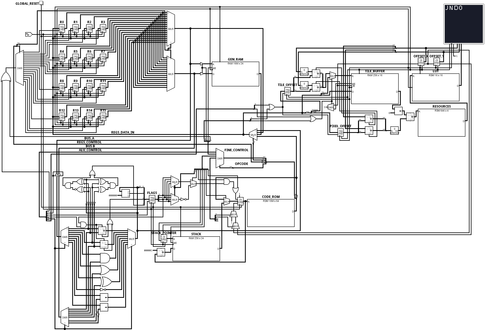

# CPU Details - Milo CPU

Versión: 2.0.0



## Introducción

Milo es un procesador de propósito general de 24 bits diseñado alrededor de una arquitectura basada en registros, una unidad de control cableada y un datapath sincronizado por ciclos de reloj.

La CPU constituye el núcleo de procesamiento de la arquitectura Milo. Su diseño define los componentes necesarios para ejecutar instrucciones, realizar operaciones sobre datos, controlar el flujo de ejecución y acceder a las memorias del sistema.

Los periféricos no forman parte obligatoria de la CPU. Una implementación de Milo puede integrar diferentes periféricos según el propósito del sistema, utilizando los mecanismos de comunicación definidos por la arquitectura.

Este documento describe la organización interna de la CPU y el comportamiento de sus principales componentes físicos.

La semántica de las instrucciones visibles para el programador se encuentra definida en el documento [Milo ISA](./ISA.md), mientras que la representación binaria de las instrucciones se describe en [Instruction Encoding Specification](./InstructionEncoding.md).

---

## Especificaciones

| Componente                     | Especificación                        |
| ------------------------------ | ------------------------------------- |
| Arquitectura                   | 24 bits                               |
| Banco de registros             | 16 registros de 24 bits               |
| Registros direccionables       | R0–R7                                 |
| Registros de propósito general | R0–R15                                |
| Program Counter                | 24 bits                               |
| Stack Pointer                  | 16 bits                               |
| Status Register                | Flags N, Z, C y V                     |
| Unidad de control              | Hardwired Control Unit                |
| ALU                            | Unidad aritmética y lógica de 24 bits |
| Memoria de programa            | ROM                                   |
| Memoria de datos               | RAM independiente                     |
| Ancho de palabra de RAM        | 24 bits                               |
| Direcciones de RAM             | 24 bits                               |
| Organización de RAM            | Un solo puerto                        |
| Lectura de RAM                 | Asíncrona                             |
| Escritura de RAM               | Síncrona, flanco de subida            |
| Buses internos                 | Bus A, Bus B y Bus C                  |
| Control de flujo               | PC + Stack + saltos                   |
| Periféricos                    | Dependientes de la implementación     |

---

# Organización interna

## Banco de registros

La CPU dispone de un banco de dieciséis registros de propósito general de 24 bits.

Aunque todos los registros pertenecen al mismo banco físico, se encuentran divididos en dos grupos según las operaciones que pueden realizar:

| Registros | Propósito general | Direccionamiento de memoria |
| --------- | ----------------- | --------------------------- |
| `R0–R7`   | Sí                | Sí                          |
| `R8–R15`  | Sí                | No                          |

Los registros `R0–R7` pueden utilizarse tanto para operaciones generales como para proporcionar direcciones de memoria.

Los registros `R8–R15` pueden utilizarse como operandos y destinos de propósito general, pero no pueden utilizarse para proporcionar directamente una dirección de memoria.

Esta división permite conservar dieciséis registros disponibles para operaciones generales sin requerir que todos ellos estén conectados al sistema de direccionamiento de memoria.

### Puertos del banco de registros

El banco de registros dispone de dos puertos de lectura independientes y un puerto de escritura.

Esto permite que una instrucción pueda obtener simultáneamente dos operandos desde el banco de registros y almacenar un resultado durante el mismo ciclo de ejecución.

La selección de los registros utilizados por cada instrucción es determinada por la lógica de control del procesador.

Los registros de propósito general no incluyen registros dedicados exclusivamente al almacenamiento de direcciones o datos. Las funciones específicas de direccionamiento son determinadas por las conexiones del datapath y las señales de control.

---

## Unidad Aritmético-Lógica

La Unidad Aritmético-Lógica (ALU) es el componente encargado de realizar las operaciones aritméticas, lógicas y de comparación sobre datos de 24 bits.

La ALU se divide conceptualmente en dos componentes principales:

* **Unidad de operaciones:** realiza la operación seleccionada sobre los operandos.
* **Unidad de flags:** determina el estado de las banderas asociado al resultado de la operación.

La unidad de operaciones implementa:

* `ADD`
* `ADC`
* `SUB`
* `SBC`
* `AND`
* `OR`
* `XOR`
* `NOT`
* `SHL`
* `SHR`
* `CMP`

El resultado generado por la ALU puede ser dirigido hacia los destinos permitidos por la instrucción y las señales de control correspondientes.

### Unidad de flags

La unidad de flags recibe información del resultado generado por la ALU y determina el estado de las banderas del procesador cuando la instrucción solicita su actualización.

El Status Register contiene:

* `N` — Negative
* `Z` — Zero
* `C` — Carry
* `V` — Overflow

La lógica de actualización de las banderas se encuentra separada de la unidad encargada de realizar la operación principal de la ALU.

---

## Sistema de buses

La CPU utiliza tres buses internos principales:

* Bus A
* Bus B
* Bus C

Los buses A y B proporcionan los operandos utilizados por los bloques funcionales del datapath.

El Bus C funciona como bus de distribución y escritura, permitiendo transportar resultados y otros datos hacia los destinos correspondientes.

La selección de las fuentes y destinos de los buses se realiza mediante la lógica de control de la CPU.

Esta organización permite que una instrucción pueda obtener dos valores de entrada y distribuir un resultado dentro del mismo ciclo de ejecución.

---

## Sistema de direccionamiento

El sistema de direccionamiento de Milo se encuentra separado del banco de registros de propósito general.

La CPU utiliza tres componentes principales para controlar el flujo de direcciones:

* Program Counter (`PC`)
* Stack Pointer (`SP`)
* Stack

### Program Counter

El Program Counter es un registro de 24 bits que contiene la dirección de la siguiente instrucción que debe ser ejecutada.

El PC se encuentra conectado directamente a la memoria de programa, permitiendo obtener la instrucción correspondiente a la dirección almacenada.

En condiciones normales, el PC avanza secuencialmente durante la ejecución del programa.

Las instrucciones de control de flujo pueden modificar su contenido para realizar:

* Saltos.
* Llamadas a subrutinas.
* Retornos.
* Saltos condicionales.
* Otros mecanismos de control implementados por la arquitectura.

### Stack

El stack de Milo utiliza actualmente una memoria independiente de la RAM de datos. Su propósito es almacenar las direcciones de retorno y la información necesaria para el mecanismo de subrutinas.

La memoria del stack posee las siguientes características:

| Característica   | Valor                         |
| ---------------- | ----------------------------- |
| Direccionamiento | 8 bits                        |
| Profundidad      | 256 posiciones                |
| Ancho de palabra | 24 bits                       |
| Lectura          | Asíncrona                     |
| Escritura        | Sincrónica                    |
| Actualización    | Flanco de subida              |
| Transferencia    | Palabras completas de 24 bits |
| Puerto           | Un puerto                     |

El **Stack Pointer (SP)** utiliza 8 bits para seleccionar la posición dentro de esta memoria. Cada posición almacena una palabra completa de 24 bits, por lo que las direcciones de retorno pueden almacenarse directamente sin dividirlas en varias operaciones.

La lectura del stack es asíncrona: una vez establecida la posición mediante el `SP`, el contenido correspondiente puede propagarse hacia el datapath sin esperar un flanco de reloj. Las escrituras, en cambio, se realizan de forma sincrónica y se hacen efectivas en el flanco de subida del reloj.

Actualmente, esta memoria se implementa físicamente como una RAM independiente de la RAM de datos. Esta separación no constituye necesariamente una restricción permanente de la arquitectura. Se evaluará posteriormente la posibilidad de:

* implementar el stack mediante una memoria completamente sincrónica;
* integrar el espacio del stack dentro de la RAM de datos;
* o mantener una memoria físicamente independiente.

Por tanto, la arquitectura define el **comportamiento del stack**, mientras que su integración física podrá modificarse en futuras implementaciones sin alterar necesariamente la interfaz arquitectónica del CPU.

### Stack Pointer

El Stack Pointer controla la posición utilizada por la pila de hardware.

A diferencia del PC, el Stack Pointer utiliza 8 bits para representar posiciones dentro del espacio destinado al Stack.

El Stack es utilizado principalmente para almacenar direcciones de retorno durante las llamadas a subrutinas.

Las instrucciones `CALL` y `RET` utilizan el Stack Pointer para realizar automáticamente las operaciones necesarias sobre la pila.

---

# Sistema de memoria

Milo utiliza una organización de memoria separada entre la memoria de programa y la memoria de datos.

```text
              ROM
               │
               ▼
        +-------------+
        |     CPU     |
        +-------------+
               │
               ▼
              RAM
```

La memoria de programa y la memoria de datos no forman una jerarquía común.

## Memoria de programa

La memoria de programa contiene las instrucciones que serán ejecutadas por la CPU.

El Program Counter proporciona directamente la dirección utilizada para acceder a esta memoria.

La ROM almacena las instrucciones completas utilizadas por el procesador y constituye la fuente principal de información para la unidad de control durante la ejecución.

La memoria de programa se encuentra separada de la RAM utilizada para almacenar datos.

---

## Memoria RAM

La RAM constituye la memoria de datos de la CPU y se encuentra físicamente separada de la memoria de programa.

Su organización es:

| Característica        | Especificación   |
| --------------------- | ---------------- |
| Ancho de dirección    | 24 bits          |
| Espacio direccionable | `2²⁴` palabras   |
| Ancho de palabra      | 24 bits          |
| Organización          | Un solo puerto   |
| Lectura               | Asíncrona        |
| Escritura             | Síncrona         |
| Flanco de escritura   | Flanco de subida |

Cada posición de memoria almacena una palabra completa de 24 bits.

La RAM utiliza un único puerto para las operaciones de acceso. Por lo tanto, las operaciones de lectura y escritura se realizan sobre una única dirección de memoria establecida para cada operación.

### Lectura

La lectura de RAM es asíncrona.

Cuando una dirección válida se encuentra establecida en la entrada de dirección de la memoria, el contenido correspondiente puede propagarse hacia la salida sin esperar un flanco de reloj.

Esto permite que los datos almacenados en RAM participen directamente en las operaciones del datapath durante el ciclo de ejecución.

### Escritura

La escritura de RAM es síncrona.

El dato presente en la entrada de escritura se almacena en la dirección seleccionada cuando ocurre el flanco de subida del reloj.

Por lo tanto, una modificación sobre la RAM se hace efectiva de forma sincronizada con el reloj del procesador.

### Acceso de palabra completa

La RAM opera sobre palabras completas de 24 bits.

Cada operación de lectura proporciona una palabra completa de 24 bits y cada operación de escritura almacena una palabra completa de 24 bits.

La arquitectura no realiza accesos parciales a bytes o grupos de bits dentro de una palabra de memoria.

---

# Unidad de control

La unidad de control implementa una lógica cableada (*Hardwired Control Unit*).

Cada instrucción contiene la información necesaria para determinar la operación que debe realizar el datapath.

La unidad de control decodifica dicha información y genera las señales necesarias para controlar los diferentes componentes del procesador.

Entre los componentes controlados se encuentran:

* Banco de registros.
* ALU.
* Unidad de flags.
* Program Counter.
* Stack Pointer.
* Sistema de memoria.
* Selección de buses.
* Sistema de direccionamiento.
* Destinos de escritura.

La unidad de control no utiliza memoria de microcódigo.

Las señales de control son generadas mediante lógica cableada y lógica combinacional asociada a la instrucción en ejecución.

---

# Ejecución de instrucciones

Milo utiliza un modelo de ejecución sincronizado por ciclos de reloj.

Durante cada ciclo, la instrucción determina la configuración necesaria del datapath para realizar la operación correspondiente.

Los datos pueden propagarse a través de los buses y bloques funcionales durante el ciclo, mientras que las modificaciones sobre elementos síncronos se hacen efectivas en el flanco correspondiente del reloj.

Entre los elementos que utilizan comportamiento síncrono se encuentran:

* Banco de registros.
* Program Counter.
* Stack Pointer.
* Stack.
* Escritura de RAM.
* Status Register cuando se actualizan las flags.

La RAM, por el contrario, proporciona lectura asíncrona.

Este modelo permite mantener un comportamiento determinista y directamente relacionado con los ciclos de reloj de la CPU.

---

# Interfaz con periféricos

La CPU puede comunicarse con periféricos externos mediante interfaces definidas por la implementación concreta del sistema.

Los periféricos no forman parte obligatoria del núcleo de la CPU.

Una implementación puede integrar diferentes recursos según su propósito, por ejemplo:

* Sistemas de entrada.
* Sistemas gráficos.
* Audio.
* Almacenamiento.
* Comunicación.
* Temporización.
* Otros dispositivos especializados.

La CPU proporciona los mecanismos necesarios para intercambiar información con estos recursos, mientras que las características concretas de cada periférico se especifican en su documentación correspondiente.

De esta forma, diferentes productos pueden utilizar el mismo núcleo de procesamiento Milo y proporcionar conjuntos de periféricos diferentes.

---

# Implementaciones de Milo

La arquitectura Milo puede utilizarse como base para diferentes tipos de sistemas.

El núcleo de CPU mantiene la misma arquitectura fundamental, mientras que los periféricos integrados pueden variar según el propósito de la implementación.

Entre las implementaciones previstas se encuentran:

### Milo Core

Implementación orientada a sistemas de tipo microcontrolador.

Está destinada a sistemas donde resulta prioritario disponer de procesamiento determinista y un conjunto reducido de recursos externos.

### Milo Console

Implementación orientada a sistemas de entretenimiento y procesamiento gráfico.

Integra periféricos especializados para las funciones necesarias del sistema, incluyendo los recursos gráficos correspondientes.

---

# Características de la implementación actual

La implementación actual de Milo incluye:

* CPU de 24 bits.
* Banco de 16 registros de propósito general.
* Restricción de direccionamiento mediante `R0–R7`.
* Program Counter de 24 bits.
* Stack Pointer.
* Stack de hardware.
* ALU de 24 bits.
* Unidad independiente para cálculo de flags.
* Status Register con `N`, `Z`, `C` y `V`.
* Tres buses internos.
* Unidad de control cableada.
* ROM de programa independiente.
* RAM de datos independiente.
* RAM de 24 bits de dirección y 24 bits de palabra.
* Lectura asíncrona de RAM.
* Escritura síncrona de RAM en flanco de subida.
* RAM de un solo puerto.
* Ejecución sincronizada por ciclos de reloj.

Los periféricos concretos implementados por una versión determinada de Milo se documentan de forma independiente y no forman parte de esta lista de componentes fundamentales de la CPU.

---

> **Nota de evolución**
>
> Las versiones anteriores de Milo integraban la descripción de la CPU y los periféricos específicos dentro del mismo modelo de arquitectura.
>
> La arquitectura actual separa el núcleo de procesamiento de los periféricos integrados. Esta separación permite utilizar la misma CPU en diferentes implementaciones, desde sistemas de tipo microcontrolador hasta sistemas orientados a consola o computadores capaces de ejecutar un sistema operativo.
