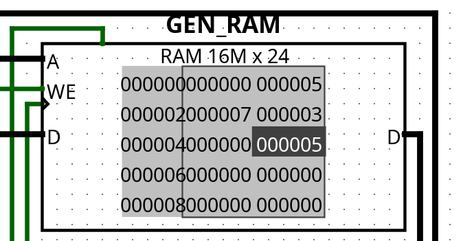
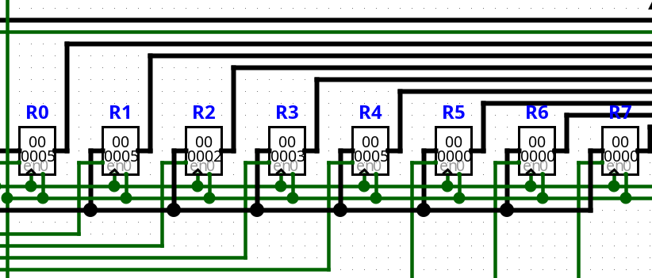

# Test Movimiento General

El test **Movimiento General** verifica la correcta generación de código para la instrucción `MOV` de la arquitectura Milo, cubriendo las diferentes combinaciones de transferencia de datos entre el banco de registros, los valores inmediatos y la memoria RAM.

La prueba está diseñada para validar el funcionamiento del sistema de operandos de la ISA V2, en el que el direccionamiento de memoria y los valores inmediatos pueden utilizarse directamente como operandos de una instrucción.

Estas operaciones permiten comprobar las rutas de datos asociadas al **Bus C**, así como la correcta selección de fuentes, destinos y control de escritura durante la ejecución de las instrucciones.

## Escenarios cubiertos

Actualmente la prueba incluye las siguientes instrucciones:

```asm
; ---------- Movimiento general ----------
MOV R0, #5          ; R0 = 5
MOV R2, #2          ; R2 = 2
MOV R1, R0          ; R1 = 5

; ---------- Registro -> RAM ----------
MOV [#1], R0        ; RAM[1] = 5
MOV [R0], R1        ; RAM[5] = 5

; ---------- Inmediato -> RAM ----------
MOV [#3], #3        ; RAM[3] = 3
MOV [R2], #7        ; RAM[2] = 7

; ---------- RAM -> Registro ----------
MOV R3, [#3]        ; R3 = 3
MOV R4, [R0]        ; R4 = 5

; ---------- RAM -> RAM ----------
MOV [#3], RAM       ; RAM[3] = RAM[3]
```

Con esta secuencia se validan las siguientes formas de `MOV`:

* Registro → registro: `MOV Rn, Rn`.
* Inmediato → registro: `MOV Rn, #n`.
* Registro → RAM con dirección inmediata: `MOV [#n], Rn`.
* Registro → RAM con dirección almacenada en registro: `MOV [Rn], Rn`.
* Inmediato → RAM con dirección inmediata: `MOV [#n], #n`.
* Inmediato → RAM con dirección almacenada en registro: `MOV [Rn], #n`.
* RAM → registro con dirección inmediata: `MOV Rn, [#n]`.
* RAM → registro con dirección almacenada en registro: `MOV Rn, [Rn]`.
* RAM → RAM utilizando la misma referencia de dirección: `MOV [#n], RAM`.

La prueba permite verificar que los diferentes tipos de operandos puedan ser utilizados directamente por la instrucción `MOV`, sin requerir instrucciones independientes de carga o almacenamiento.

## Direccionamiento de memoria

En la ISA V2, una referencia entre corchetes establece la dirección de acceso a la RAM:

```asm
[#n]
[Rn]
```

Una vez establecida esta dirección, el operando `RAM` representa la palabra de memoria correspondiente a dicha dirección.

Por ejemplo:

```asm
MOV [#3], RAM
```

representa:

```text
RAM[3] ← RAM[3]
```

Esta instrucción es sintácticamente válida y permite comprobar que el mecanismo de direccionamiento y la selección de RAM funcionan correctamente, aunque el resultado de la operación no modifique el contenido de memoria.

La ISA permite una única referencia de dirección `[...]` por instrucción. Todas las apariciones posteriores de `RAM` dentro de la misma instrucción utilizan esa misma dirección.

## Uso de valores inmediatos

Los valores inmediatos se encuentran representados mediante el campo **Immediate/Payload** de 24 bits de la instrucción.

Una instrucción puede utilizar varias referencias al mismo valor inmediato, siempre que todas representen el mismo valor.

Por ejemplo:

```asm
MOV [#3], #3
```

es válida porque ambas referencias utilizan el valor `3`.

En cambio:

```asm
MOV [#3], #7
```

no es válida, ya que requeriría representar dos valores inmediatos diferentes dentro de un único campo Immediate/Payload.

## Resultado esperado

La compilación debe finalizar correctamente y generar el archivo:

`compilaciones/instrucciones/test_movimiento_general.txt`

El archivo generado contiene las instrucciones codificadas de 64 bits correspondientes al programa de prueba y puede utilizarse posteriormente para verificar la ejecución del programa en el procesador Milo.

Durante la ejecución debe observarse el siguiente estado final:

### Banco de registros

| Registro | Valor esperado |
| -------- | -------------: |
| `R0`     |            `5` |
| `R1`     |            `5` |
| `R2`     |            `2` |
| `R3`     |            `3` |
| `R4`     |            `5` |

Los registros `R5`–`R15` no son modificados por este test.

### Memoria RAM

| Dirección | Valor esperado |
| --------: | -------------: |
|  `RAM[1]` |            `5` |
|  `RAM[2]` |            `7` |
|  `RAM[3]` |            `3` |
|  `RAM[5]` |            `5` |

Las demás posiciones de memoria no son modificadas por este programa.

## Verificaciones realizadas

El test permite comprobar conjuntamente:

* Selección de registros como fuente y destino.
* Selección de valores inmediatos como operandos.
* Selección de RAM como fuente.
* Escritura de datos hacia RAM mediante Bus C.
* Lectura de datos desde RAM.
* Uso de registros `R0–R7` como fuentes de dirección para el MAR.
* Uso de valores inmediatos como fuentes de dirección.
* Correcta selección de `RegSrcA`, `RegSrcB` y `RegDest`.
* Correcta integración entre el sistema de operandos del parser, el encoder y el datapath.
* Correcta interpretación de las referencias `[...]` y `RAM`.

Este test constituye una prueba fundamental de la arquitectura de operandos de la ISA V2, ya que una misma instrucción puede combinar diferentes fuentes y destinos sin depender de instrucciones especializadas para cada operación de memoria.



